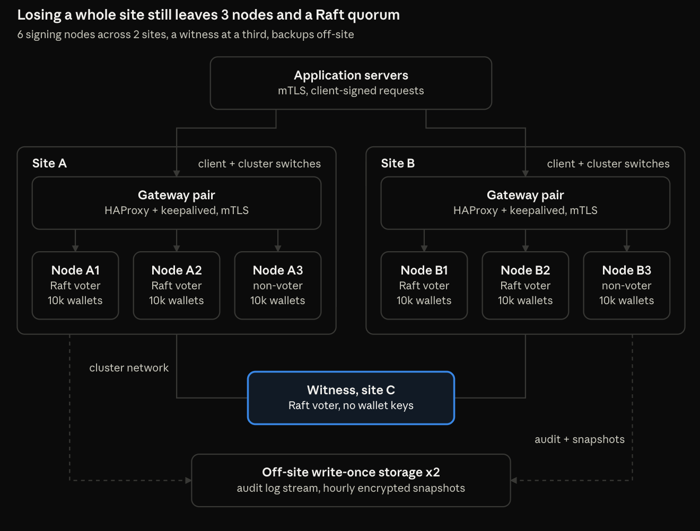
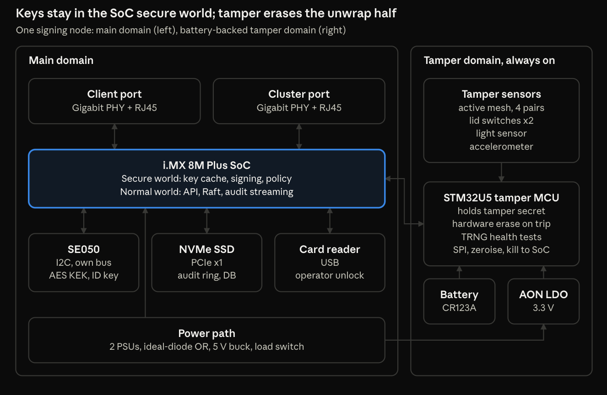

# OpenHSM

An open-source, DIY hardware security module designed to run as a redundant cluster for high-throughput crypto wallet signing.

OpenVault is a reference design for building your own HSM cluster from off-the-shelf parts. It includes open hardware, open firmware and reproducible builds. A six-node cluster across two sites sustains **1,000 signed transfers per second** even with a whole site offline, and each node holds **10,000 wallets** derived from a single root seed.

## Highlights

- **Keys never leave the secure world.** Signing runs inside OP-TEE on an NXP i.MX 8M Plus. An NXP SE050 secure element and a battery-backed STM32U5 tamper supervisor each hold half of the node's unwrap key.
- **Active tamper response.** A mesh enclosure, lid switches, a light sensor and an accelerometer trigger hardware erasure of the unwrap secret.
- **Built for failure.** Raft replication with a keyless witness at a third site. Failover takes under 5 s, and the cluster survives the loss of a full site.
- **Policy enforced on the HSM.** Per-wallet spending caps, allow-lists and leased daily limits stop a compromised application server from draining funds.
- **Layered backup.** Live replicas, encrypted off-site snapshots, and a root seed split 3-of-5 with SLIP-39.
- **Multi-chain.** Supports secp256k1 ECDSA, BIP-340 Schnorr and Ed25519, covering Bitcoin, Ethereum and EVM chains, Solana, Cosmos and more.

## What's in this repo

Schematics and signal-level netlists, a full bill of materials, cluster architecture, capacity maths, the key hierarchy and ceremony, disaster-recovery runbooks, and a build and test checklist.

> **Note:** OpenVault is not FIPS 140-3 or Common Criteria certified. Where regulation or insurance requires certified key storage, use it for development or lower-value hot wallets, or keep the root seed in a certified device. Benchmark on your own hardware before going live.

# System Requirements

| Target | Value |
|--------|-------|
| Sustained signing | 1,000 sig/s with one site (3 nodes) lost |
| Burst | 3,000 sig/s for 60 s with all nodes up |
| Sign latency | p99 under 50 ms at the HSM API |
| Wallets | 10,000 per partition, every node holds every partition |
| Curves | secp256k1 ECDSA + Schnorr (BIP-340), Ed25519 |
| Node failover | under 5 s, no lost requests (client retries with idempotency key) |
| Wallet-creation RPO | 0: a wallet exists only once written to a quorum |
| Site-loss RTO | under 30 s |

# Bill of Materials

| Qty | Item | Notes |
|-----|------|-------|
| 1 | [i.MX 8M Plus quad SOM, 4–8 GB LPDDR4, 32 GB eMMC](https://www.mouser.co.uk/en/ProductDetail/NXP-Semiconductors/8MPLUSLPD4-EVK?qs=sGAEpiMZZMv0WPLDnYsI7z%252BJKhWGmFt4C%252BT8bKH1DJMnMT5qg1wHVg%3D%3D) | Pick a vendor that publishes HAB secure-boot docs and mainline U-Boot/OP-TEE support |
| 1 | Custom carrier PCB, 6-layer | Section 5 |
| 1 | [NXP SE050 (AES + P-256 variant)](https://www.mouser.co.uk/en/ProductDetail/NXP-Semiconductors/SE050C1HQ1-Z01SCZ?qs=uwxL4vQweFPAe9Cpm7Fm%252BQ%3D%3D) | 5.3 |
| 1 | [STM32U5, LQFP64, not U575/585 rev X](https://www.mouser.co.uk/en/ProductDetail/STMicroelectronics/STM32U595RJT6Q?qs=sGAEpiMZZMuI9neUTtPr757IDD%2FwidVOeNx%252BK87m1RZ2F32QVOiwxQ%3D%3D) | Tamper Supervisor |
| 1 | [Low-power 3-axis accelerometer](https://www.mouser.co.uk/en/ProductDetail/STMicroelectronics/AIS328DQTR?qs=LYO3r17CQdPWOQ2wXNVBxw%3D%3D) | Tamper: movement |
| 1 | Photodiode + comparator | Tamper: light |
| 2 | [Normally-closed microswitch](https://www.mouser.co.uk/en/ProductDetail/TE-Connectivity-Alcoswitch/SAJ101XRHLN74SDTPTQ?qs=7MVldsJ5UazROW4Ax1GBQQ%3D%3D&mgh=1&vip=1&utm_id=20797887765&utm_source=google&utm_medium=cpc&utm_marketing_tactic=emeacorp&gad_source=1&gad_campaignid=20808116062&gclid=CjwKCAiAzKvXBhBAEiwABLl9AkOKdimXGZGH7wUT0jrg68YRtqmUqSESL2dKNqFZ-Koe49nV-s2gixoCz8EQAvD_BwE) | Tamper: lid |
| 1 | Mesh flex PCB, 4 serpentine pairs, 0.15 mm | Wraps the inner can |
| 1 | [CR123A cell](https://uk.farnell.com/panasonic/cr-123apa-be/battery-lithium-3v-1400mah-cr123/dp/1845622?cjdata=MXxZfDB8WXww&gross_price=true&CMP=AFC-CJ-UK-7947610&source=CJ&cjevent=dd7914bed89a11f1814f00a90a1981a1&loyaltysignal=0) + [holder](https://uk.farnell.com/multicomp-pro/mp000356/battery-holder-cr123a-pcb/dp/3126594?cjdata=MXxZfDB8WXww&gross_price=true&CMP=AFC-CJ-UK-8989328&source=CJ&cjevent=92bb662bd89a11f182d400a90a1981f9&loyaltysignal=0) | Tamper domain |
| 2 | [Gigabit RGMII PHY](https://www.mouser.co.uk/en/ProductDetail/Texas-Instruments/DP83825IRMQT?qs=B6kkDfuK7%2FBiCk9ZFiDEMg%3D%3D&mgh=1&vip=1&utm_id=20797887759&utm_source=google&utm_medium=cpc&utm_marketing_tactic=emeacorp&gad_source=1&gad_campaignid=20808115849&gclid=CjwKCAiAzKvXBhBAEiwABLl9Ap4k74rQ5ePk6MVCnfHhNI17cvC-JPekhytu_yIwNwCDDR4bKR0jOxoC3lIQAvD_BwE) + [RJ45 magjack](https://www.mouser.co.uk/en/ProductDetail/Molex/85793-1020?qs=VBGyBZiQP4EPajPaXkZR%252BA%3D%3D) | Client and cluster ports |
| 1 | 256–512 GB M.2 NVMe, high-endurance | Audit ring |
| 2 | [LM74700](https://www.mouser.co.uk/en/ProductDetail/Texas-Instruments/LM74704QDDFRQ1?qs=mELouGlnn3dgFSYOQXVXjA%3D%3D&mgh=1&vip=1&utm_id=20808080842&utm_source=google&utm_medium=cpc&utm_marketing_tactic=emeacorp&gad_source=1&gad_campaignid=20808080812&gclid=CjwKCAiAzKvXBhBAEiwABLl9Alhtq4ZNdIovGkdIL2Zf1yClDieCJzJEEKnumljLAqRaUojJHH51WxoC3aYQAvD_BwE) + [N-FET](https://www.mouser.co.uk/en/ProductDetail/STMicroelectronics/STN4NF03L?qs=QUuoqGqE2XUgPLBORZvXqA%3D%3D&mgh=1&vip=1&utm_id=20808080842&utm_source=google&utm_medium=cpc&utm_marketing_tactic=emeacorp&gad_source=1&gad_campaignid=20808080812&gclid=CjwKCAiAzKvXBhBAEiwABLl9AlAelF3J2_p8z70bVCgeFC2-hFT7duyeSD5_rafjo7THNkuYpd7n3BoCHYcQAvD_BwE) | Power ORing |
| 1 | [12 V to 5 V 6 A buck](https://www.mouser.co.uk/en/ProductDetail/MEAN-WELL/PSD-45A-5?qs=sGAEpiMZZMsc0tfZmXiUnQDHQLsQHd4KvFzg3hJUk%252BsM23tWxVLv2Q%3D%3D), [5 V load switch](https://www.mouser.co.uk/en/ProductDetail/Texas-Instruments/TPS2117DRLR?qs=HoCaDK9Nz5c%2FKe5lpCPPWQ%3D%3D&mgh=1&vip=1&utm_id=20808080842&utm_source=google&utm_medium=cpc&utm_marketing_tactic=emeacorp&gad_source=1&gad_campaignid=20808080812&gclid=CjwKCAiAzKvXBhBAEiwABLl9AnE_74_UEMQNaMWHqmRKGfrUVJKx0imlvLxc8OIwBcspy7oYQlbFihoCFu8QAvD_BwE), [3.3 V low-Iq LDO](https://www.mouser.co.uk/en/ProductDetail/STMicroelectronics/LD1117AS33TR?qs=C3bf%2FVrkE5CoDDd7wyn%252BaQ%3D%3D&mgh=1&vip=1&utm_id=20808080842&utm_source=google&utm_medium=cpc&utm_marketing_tactic=emeacorp&gad_source=1&gad_campaignid=20808080812&gclid=CjwKCAiAzKvXBhBAEiwABLl9AuGsVfJnj3fxUe93P8Jwq_0CBk6TtWfPvZnCnAFySMGqfUHCzOpg3RoCK1EQAvD_BwE), [supervisor](https://www.mouser.co.uk/en/ProductDetail/Texas-Instruments/TLV803EA43VDBZR?qs=eP2BKZSCXI4fg9n64ahjIg%3D%3D&mgh=1&vip=1&utm_id=20808080842&utm_source=google&utm_medium=cpc&utm_marketing_tactic=emeacorp&gad_source=1&gad_campaignid=20808080812&gclid=CjwKCAiAzKvXBhBAEiwABLl9Al3fAqFDU0GygOMDyirvrQ4mGpkdHifHOYjOnVYpTf5g158BMkclORoCbIUQAvD_BwE) | 5.1 |
| 1 | Transistor, op-amp, passives for avalanche TRNG | 5.4 |
| 1 | Inner steel can, potting compound, 1U chassis, heatsink | 5.6 |
| 2 | [12 V PSU](https://www.mouser.co.uk/en/ProductDetail/TRACO-Power/TPP-65-321M2?qs=sGAEpiMZZMs2%252BVrH5rwl1id2VXUzi3Lii24GqnUNwzGlvbhsaKOHlw%3D%3D) | One per PDU |
| 1 | USB CCID smartcard reader | Front panel |

