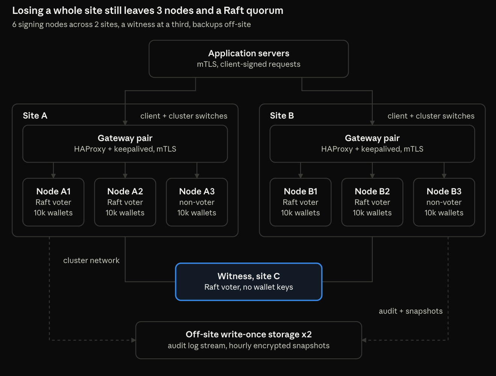
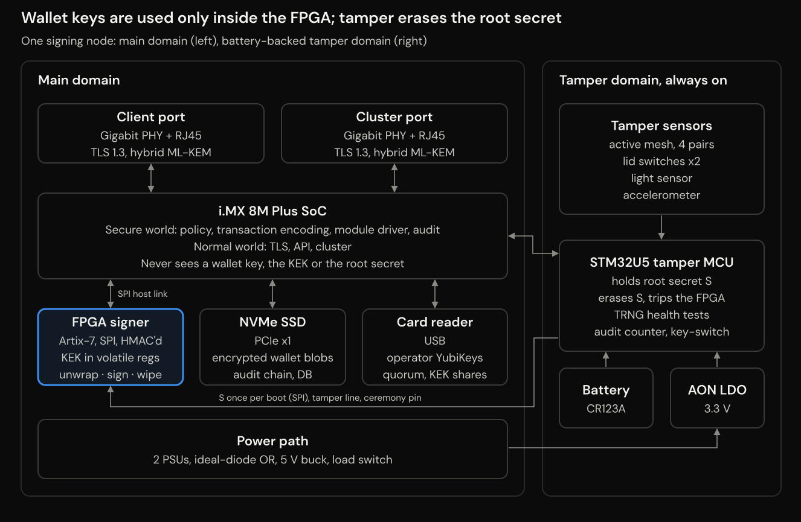

# OpenHSM

An open-source, DIY hardware security module designed to run as a redundant cluster for high-throughput crypto wallet signing.

OpenHSM is a reference design for building your own HSM cluster from off-the-shelf parts. It includes open hardware, open firmware and reproducible builds. Each node signs with an FPGA that does one job, secp256k1 ECDSA for Ethereum and Bitcoin, at an estimated **28 to 55 signatures per second per node**, and any node can sign for any of **10,000 wallets** because the FPGA keeps no wallet state. Throughput grows with the number of nodes; see [Estimated throughput](#estimated-throughput).

## Highlights

- **Wallet keys are only used inside the FPGA.** A Xilinx Artix-7 signing module generates wallet keys, unwraps them under the cluster key-encryption key (KEK) and signs. Keys are stored only as AES-256-GCM blobs. The NXP i.MX 8M Plus handles TLS, policy and transaction encoding but never sees a private key, the KEK or the root secret.
- **Authenticated host link.** Every command and every response between the SoC and the FPGA carries an HMAC, over an SPI link fast enough for future post-quantum signatures.
- **Active tamper response.** A battery-backed STM32U5 supervisor holds the root secret S. A mesh enclosure, lid switches, a light sensor and an accelerometer make it erase S and clear the FPGA's key registers.
- **Built for failure.** Raft replication with a keyless witness at a third site. Failover takes under 5 s, and the cluster survives the loss of a full site.
- **Policy enforced on the HSM.** Per-wallet spending caps, allow-lists and leased daily limits stop a compromised application server from draining funds.
- **Layered backup.** Live replicas, encrypted off-site snapshots, and the KEK split m-of-n with Shamir sharing, one share per operator card (YubiKey).
- **Ethereum and Bitcoin.** secp256k1 ECDSA only, done in hardware: Ethereum and EVM transactions (EIP-1559, EIP-155, ERC-20) and Bitcoin native SegWit (P2WPKH). BIP-340 Schnorr and Ed25519 are not supported.
- **Preparing for post-quantum Ethereum.** Hybrid ML-KEM TLS on every network link, an SPI host link with room for kilobyte hash-based signatures, and a Keccak-256 core in the FPGA. The plan for Ethereum's move to hash-based signatures is in [docs/POST_QUANTUM.md](docs/POST_QUANTUM.md).

## What's in this repo

Schematics and signal-level netlists, a full bill of materials, cluster architecture, capacity maths, the key hierarchy and ceremony, disaster-recovery runbooks, and a build and test checklist.

> **Note:** OpenHSM is not FIPS 140-3 or Common Criteria certified. Where regulation or insurance requires certified key storage, use it for development or lower-value hot wallets, or keep the KEK backups in a certified device. Benchmark on your own hardware before going live.





# Estimated throughput

Every node can sign for every wallet, so cluster throughput is the per-node rate times the number of nodes serving requests. The per-node rate is set by the FPGA:

| Signature check (`VERIFY_SIGN`) | Time per request | Per node |
|---|---|---|
| On (default): each signature is checked before release, which catches fault attacks | 34.9 ms | **28.6 sig/s** |
| Off | 18.2 ms | **54.9 sig/s** |

| Nodes | All nodes up, check on | All nodes up, check off | One node down, check on | One node down, check off |
|---|---|---|---|---|
| 2 | 57 | 110 | 29 | 55 |
| 3 | 86 | 165 | 57 | 110 |
| 4 | 115 | 220 | 86 | 165 |
| 5 | 143 | 275 | 115 | 220 |
| 6 | 172 | 330 | 143 | 275 |
| 7 | 201 | 385 | 172 | 330 |
| 8 | 229 | 440 | 201 | 385 |
| 9 | 258 | 495 | 229 | 440 |
| 10 | 287 | 549 | 258 | 495 |

Signatures per second, rounded. For two sites with one site lost, read the row for the nodes left standing (six nodes across two sites: the row for 3).

How these were worked out, and what they leave out:

- The FPGA time is from simulation at a 100 MHz clock: 3,469,730 cycles per signature with the check on (34.7 ms), plus about 0.2 ms on the 12.5 MHz SPI link. Nothing has been measured on hardware.
- The SoC's own work per request (TLS, request signature check, policy, transaction encoding, audit write) is assumed to keep up with the FPGA. It has not been measured on the i.MX 8M Plus.
- Load is assumed to spread evenly across nodes, and signing needs no cluster round trip (spending limits use leases).
- The RTL does not yet fit the XC7A50T (see the bill of materials). A larger part or a smaller design does not change these rates.

The earlier target of 1,000 signatures per second would need 35 nodes with the check on, or 19 with it off. The ways to raise the per-node rate are a second signer core in the FPGA (section 9 of the [FPGA specification](FPGA/README.md)) or a faster clock after timing closure.

# Market competitiveness

The HSM market was worth roughly US$2 billion in 2026 and is forecast to grow 10 to 15% a year ([Mordor Intelligence](https://www.mordorintelligence.com/industry-reports/hardware-security-modules-market), [MarketsandMarkets](https://www.marketsandmarkets.com/Market-Reports/hardware-security-modules-market-162277475.html)). Payment processing is the largest use; blockchain and crypto custody is a smaller, faster-growing part, pushed in Europe by MiCA. A few vendors (Thales, Entrust, Utimaco) dominate, and appliances typically sell for US$20,000 to 50,000 each before licences ([ABI Research](https://abiresearch.com/market-research/insight/7783874-nitrokey-hsm-a-tough-sell-in-a-highly-dema)). Much institutional crypto custody has moved to MPC platforms such as Fireblocks, BitGo and Cobo instead of HSMs.

| | OpenHSM (this design) | Securosys Primus X | Thales Luna Network HSM 7 | AWS CloudHSM | Nitrokey NetHSM | MPC platforms (e.g. Fireblocks) |
|---|---|---|---|---|---|---|
| Kind | Open hardware HSM node, crypto-only | Appliance with blockchain features | General-purpose appliance | Rented HSM | Open-source general-purpose appliance | Software key shares, managed service |
| Price | About US$640–1,200 per node in one-off parts ([costing](#estimated-cost-per-node)) | Not published | Not published; market typical US$20,000–50,000 | US$1.60 an hour per HSM, about US$1,150 a month | Under €10,000 | Subscription, not published |
| Elliptic-curve signing speed per unit | 28.6–55 sig/s (estimate, secp256k1) | 30,000 ECC-256 per second (X2P EC) | Over 20,000 ECC operations per second | Not compared here | "Thousands" of key operations per second | Software; not HSM-bound |
| Certification | None | FIPS 140 validated | FIPS validated | FIPS validated | Not checked | Depends on provider |
| Source code | Hardware, RTL and software all open | Closed | Closed | Closed | Open | Closed |
| Crypto policy inside the HSM (limits, allow-lists) | Yes | Blockchain-specific features | No | No | No | Yes, in the platform |
| Post-quantum | Hybrid ML-KEM TLS now; hash-based signing planned ([plan](docs/POST_QUANTUM.md)) | PQC and hybrid signatures supported | PQC listed | Not covered here | Not covered here | Not covered here |

Vendor figures are as each vendor publishes them and are not directly comparable: they are for general ECC (usually P-256) on production hardware, against an estimate for secp256k1 from simulation.

**Where OpenHSM can win**

- **Cost.** A first costing puts a node at about US$640–1,200 in one-off parts ([details](#estimated-cost-per-node)). Ten nodes, about 290 signatures a second today, come to roughly US$6,400–12,000: less than one US$20,000–50,000 appliance, and with no single point of failure.
- **Transparency.** Everything is open down to the signing logic in the FPGA, not just the firmware. Buyers can audit what signs their keys, and there is no vendor to trust with backdoors or end-of-life decisions.
- **Built for crypto custody.** Spending caps, allow-lists and daily limits are enforced on the HSM, so a compromised application server cannot drain wallets. General-purpose HSMs leave that to the application.
- **No counterparty.** Self-hosted, unlike rented or managed custody.
- **Early on Ethereum's post-quantum path.** The host link, hash core and key-transfer design are already aimed at Ethereum's move to hash-based signatures.

**Where it does not compete yet**

- **Throughput.** Commercial appliances are roughly 400 to 1,000 times faster per unit. OpenHSM makes up for it only by running many cheap nodes. A second signer core and a larger FPGA are the main levers.
- **Certification.** Without FIPS 140-3 or Common Criteria it cannot be the key store of a regulated or qualified custodian, which is where much of the growth is (MiCA). See [Compliance mapping](docs/COMPLIANCE.md).
- **Maturity.** No hardware has been built, the FPGA design does not yet fit the chosen part, and there has been no independent review.
- **Scope.** secp256k1 only: no Ed25519 or Schnorr chains, no general PKI or payment use.
- **Support.** No company behind it, no service-level agreement.

**Best fit today:** smaller exchanges, funds, DAOs and Web3 teams who want to hold their own Ethereum and Bitcoin keys, cannot justify US$20,000+ appliances or a managed-custody subscription, and value an auditable design over certification. Also suitable for research and teaching.

Sources: [Securosys Primus X2 factsheet](https://securosys.com/hubfs/2%20WEBSITE%20/2.1%20Products%20/2.1%20Factsheets/202502_Factsheet_X2_EN_v2.1.pdf), [Securosys Primus HSM docs](https://docs.securosys.com/primus-hsm/overview), [Thales Luna Network HSM 7](https://cpl.thalesgroup.com/encryption/hardware-security-modules/luna-7-network-hsm), [AWS: KMS or CloudHSM](https://aws.amazon.com/blogs/security/aws-kms-or-aws-cloudhsm-choose-the-right-key-management-solution/), [Nitrokey NetHSM](https://www.nitrokey.com/files/doc/Nitrokey_NetHSM_factsheet.pdf), [DigiKey XC7A50T-1FTG256C](https://www.digikey.de/en/products/detail/amd/XC7A50T-1FTG256C/5039080), [Variscite i.MX 8M Plus modules](https://shop.variscite.com/product/evaluation-kit/var-smarc-mx8m-plus-evaluation-kits/). Prices and figures checked 25 November 2026.

# System Requirements

| Target | Value |
|--------|-------|
| Signing rate | See [Estimated throughput](#estimated-throughput) |
| Sign latency | p99 under 50 ms at the HSM API (the FPGA takes about 35 ms per signature) |
| Wallets | 10,000 per partition, every node holds every partition |
| Curves | secp256k1 ECDSA |
| Node failover | under 5 s, no lost requests (client retries with idempotency key) |
| Wallet-creation RPO | 0: a wallet exists only once written to a quorum |
| Site-loss RTO | under 30 s |

# Bill of Materials

Per node. Matches the [carrier schematic](hardware/kicad/openhsm-carrier/README.md) (draft 0.2); reference designators in brackets.

| Qty | Item | Notes |
|-----|------|-------|
| 1 | [Variscite DART-MX8M-PLUS: i.MX 8M Plus quad SOM, 4–8 GB LPDDR4, 32 GB eMMC](https://shop.variscite.com/product/system-on-module/dart-mx8m-plus-system-on-module/?_gl=1*1tdgpdy*_gcl_aw*R0NMLjE3OTM4MzU1MTQuQ2p3S0NBaUF6S3ZYQmhCQUVpd0FCTGw5QXRQTlVjNzJwclB3bHdyQUxXaU11WmV0MVF0VFYwZ19vOUhuVzBOa0VpdUNndDZXMWdxMWRCb0N2VklRQXZEX0J3RQ..*_gcl_au*MTU5MTc4NDg4OS4xNzkzODM1MzAyLi0uLS4xNzkzODM1MzAxLjczODA5NjYyNi4xNzkzODM1MzAyLjE3OTM4MzU1MTM.*_ga*MTM0NTY1MDA2OS4xNzkzODM1Mjk3*_ga_HXGNGLZXPK*czE3OTM4MzUyOTUkbzEkZzEkdDE3OTM4MzU1MTMkajQkbDAkaDA.#sf_source=direct) [Dev kit](https://www.mouser.co.uk/en/ProductDetail/NXP-Semiconductors/8MPLUSLPD4-EVK?qs=sGAEpiMZZMv0WPLDnYsI7z%252BJKhWGmFt4C%252BT8bKH1DJMnMT5qg1wHVg%3D%3D) | SoC (U501). Pick a configuration with HAB secure-boot docs and mainline U-Boot/OP-TEE support |
| 1 | Custom carrier PCB, 6-layer | [KiCad schematics](hardware/kicad/openhsm-carrier/README.md) |
| 1 | Xilinx Artix-7 XC7A50T-1FTG256C FPGA | Signing module (U201). Size not confirmed: a first synthesis estimate of the RTL needs about 88,800 LUTs against this part's 32,600. The XC7A100T-1FTG256C comes in the same package ([details](docs/POST_QUANTUM.md#8-fpga-capacity)) |
| 1 | MX25L3233F 32 Mbit SPI flash | FPGA configuration (U202) |
| 1 | Abracon ASE 100 MHz oscillator | FPGA system clock (X201) |
| 1 | [STM32U595RJT6Q, LQFP64](https://www.mouser.co.uk/en/ProductDetail/STMicroelectronics/STM32U595RJT6Q?qs=sGAEpiMZZMuI9neUTtPr757IDD%2FwidVOeNx%252BK87m1RZ2F32QVOiwxQ%3D%3D) + 32.768 kHz crystal | Tamper supervisor (U301, Y301). Not U575/585 rev X |
| 1 | [ADXL363 3-axis accelerometer](https://www.analog.com/en/products/adxl363.html) | Tamper: movement (U402); about 270 nA in motion-wake mode, suits the battery domain |
| 1 | BPW34 photodiode + TLV7031 comparator | Tamper: light (D401, U401) |
| 2 | [Normally-closed microswitch](https://www.mouser.co.uk/en/ProductDetail/TE-Connectivity-Alcoswitch/SAJ101XRHLN74SDTPTQ?qs=7MVldsJ5UazROW4Ax1GBQQ%3D%3D&mgh=1&vip=1&utm_id=20797887765&utm_source=google&utm_medium=cpc&utm_marketing_tactic=emeacorp&gad_source=1&gad_campaignid=20808116062&gclid=CjwKCAiAzKvXBhBAEiwABLl9AkOKdimXGZGH7wUT0jrg68YRtqmUqSESL2dKNqFZ-Koe49nV-s2gixoCz8EQAvD_BwE) | Tamper: lid, off-board on J402 and J403 |
| 1 | Mesh flex PCB, 4 serpentine pairs, 0.15 mm | Wraps the inner can; connects on J401 |
| 1 | [CR123A cell](https://uk.farnell.com/panasonic/cr-123apa-be/battery-lithium-3v-1400mah-cr123/dp/1845622?cjdata=MXxZfDB8WXww&gross_price=true&CMP=AFC-CJ-UK-7947610&source=CJ&cjevent=dd7914bed89a11f1814f00a90a1981a1&loyaltysignal=0) + [holder](https://uk.farnell.com/multicomp-pro/mp000356/battery-holder-cr123a-pcb/dp/3126594?cjdata=MXxZfDB8WXww&gross_price=true&CMP=AFC-CJ-UK-8989328&source=CJ&cjevent=92bb662bd89a11f182d400a90a1981f9&loyaltysignal=0) | Tamper domain (BT101) |
| 1 | BAT54C diode-OR + XC6206P332 3.3 V low-Iq LDO | Always-on tamper supply: mains-derived 3.3 V or the cell (D, U109) |
| 1 | TLV803EA43 voltage supervisor | 5 V monitor (U110) |
| 1 | KSZ9031RNX gigabit RGMII PHY + 25 MHz crystal | Cluster port (U601, Y601). The client port uses the SOM's own PHY |
| 2 | [RJ45 gigabit magjack](https://www.mouser.co.uk/en/ProductDetail/Molex/85793-1020?qs=VBGyBZiQP4EPajPaXkZR%252BA%3D%3D) | Client and cluster ports |
| 1 | 256–512 GB M.2 2280 NVMe, high-endurance, + M.2 M-key socket | Audit ring and database (J701) |
| 2 | [LM74700-Q1 ideal-diode controller](https://www.ti.com/product/LM74700-Q1) + [STN4NF03L N-FET](https://www.mouser.co.uk/en/ProductDetail/STMicroelectronics/STN4NF03L?qs=QUuoqGqE2XUgPLBORZvXqA%3D%3D&mgh=1&vip=1&utm_id=20808080842&utm_source=google&utm_medium=cpc&utm_marketing_tactic=emeacorp&gad_source=1&gad_campaignid=20808080812&gclid=CjwKCAiAzKvXBhBAEiwABLl9AlAelF3J2_p8z70bVCgeFC2-hFT7duyeSD5_rafjo7THNkuYpd7n3BoCHYcQAvD_BwE) + SMBJ15A TVS | 12 V feed A/B ORing and protection (U101/U102, Q101/Q102) |
| 1 | [MEAN WELL PSD-45A-5, 12 V to 5 V 6 A](https://www.mouser.co.uk/en/ProductDetail/MEAN-WELL/PSD-45A-5?qs=sGAEpiMZZMsc0tfZmXiUnQDHQLsQHd4KvFzg3hJUk%252BsM23tWxVLv2Q%3D%3D) | Main 5 V (on J103) |
| 2 | TPS62130 3 A buck | 3.3 V main and 3.3 V NVMe (U104, U105) |
| 1 | TLV62569 buck | FPGA core 1.0 V (U106) |
| 2 | AP2112K LDO (1.8 V, 1.2 V) | FPGA VCCAUX/IO 1.8 V, PHY core 1.2 V (U107, U108) |
| 2 | TPS22917 load switch | SoC kill switch driven by the tamper MCU (U103); USB power (U701) |
| 1 | MMBT3904 + MCP6001 op-amp + passives | Avalanche-noise TRNG source (Q401, U403) |
| 1 | USB-A socket + USBLC6-2P6 ESD protection | Front-panel USB for the card reader (J702, U702) |
| 1 | Passives (68 resistors, 96 capacitors), inductors, LEDs, connectors | Draft quantities from the schematic |
| 1 | Inner steel can, potting compound, 1U chassis, heatsink | Enclosure |
| 2 | [12 V PSU, TRACO TPP 65-112 (65 W)](https://uk.farnell.com/tracopower/tpp-65-112/power-supply-medical-ac-dc-12v/dp/2829810) | One per PDU, into the 12 V feeds A and B (J101, J102) |
| 1 | USB CCID smartcard reader | Front panel, for operator YubiKeys |

## Estimated cost per node

First costing, 25 November 2026, at one-off (quantity 1) distributor prices in US dollars. Parts follow the list above. "est" marks a figure estimated from similar parts rather than a quoted price.

| Qty | Item | US$ | Basis |
|---|---|---|---|
| 1 | i.MX 8M Plus SOM, quad, 4 GB LPDDR4, 32 GB eMMC (DART-MX8M-PLUS) | 110–190 | est: Variscite from $59-79 for the smallest config; comparable 4 GB modules ~€100 (Olimex) to ~$190 (ADLINK 4G/32G) |
| 1 | FPGA XC7A50T-1FTG256C | 65–76 | DigiKey €59.55 ex VAT; Octopart $75.85 |
| 1 | FPGA config flash MX25L3233F + 100 MHz oscillator | 2–4 | est |
| 1 | STM32U595RJT6Q tamper MCU | 14 | DigiKey $14.41 |
| 1 | ADXL363 accelerometer | 8–9 | Mouser $7.57, DigiKey $9.42 |
| 1 | Light sensor: BPW34 + MCP6001/TLV7031 | 2–3 | est |
| 2 | Lid microswitches (NC) | 3–6 | est |
| 1 | Mesh flex PCB, 4 serpentine pairs | 10–30 | est (flex PCB prototype pricing) |
| 1 | CR123A cell + holder | 4–8 | est |
| 1 | KSZ9031RNX gigabit PHY (cluster port; client port uses the SOM's PHY) | 3–6 | DigiKey $2.80, LCSC $5.75 |
| 2 | RJ45 magjack | 8–16 | est |
| 1 | M.2 NVMe 256 GB, industrial | 40–177 | $40 consumer high-endurance (est) to $177 Kingston Industrial (CDW) |
| 2 | Power ORing: LM74700-Q1 + N-FET | 4–7 | est |
| 1 | 12 V to 5 V 6 A converter, MEAN WELL PSD-45A-5 | 13–21 | DigiKey $13.38, TRC $20.64 |
| 1 | Other regulators, supervisor, protection, crystals, inductors | 10–18 | est (TPS62130 x2, TLV62569, AP2112 x2, TPS22917 x2, XC6206, TLV803, BAT54C, USBLC6, SMBJ15A x2) |
| 1 | Passives (68 R, 96 C), LEDs, connectors, M.2 and USB sockets | 12–25 | est |
| 1 | Carrier PCB, 6-layer | 15–40 | est (JLCPCB 6-layer prototypes from $35 per 5 pcs at 10x10 cm; board is larger) |
| 1 | PCB assembly incl. BGA | 30–80 | est (JLCPCB setup ~$25 + per joint; BGA extra) |
| 2 | 12 V PSU, TRACO TPP 65-112 | 94–112 | Mouser/DigiKey ~$55; RS £47.44 |
| 1 | 1U chassis | 150–270 | In Win / P-Link short-depth 1U, $154-266 |
| 1 | Inner steel can, potting, heatsink | 25–60 | est |
| 1 | USB CCID smartcard reader | 15–30 | est |
| | **Total per node** | **637–1,202** | |

- **About US$1,000 per node** is a fair working figure. The electronics on the carrier come to about US$310–550; the chassis, power supplies and NVMe drive are about half the total.
- **Per cluster**, add the operator cards: five YubiKey 5 NFC at US$58 each (US$290) for a 3-of-5 split. A six-node cluster is then roughly US$4,100–7,500 in parts.
- **Not included:** VAT, shipping and tariffs, stencils and one-off setup fees, assembly labour for the enclosure and potting, testing, and engineering time.
- **Biggest uncertainties:** the SOM in the 4 GB / 32 GB configuration (Variscite quotes this on request), PCB and assembly cost at the final board size, and the enclosure. If the RTL needs the XC7A100T, add roughly the price difference between the two FPGAs.
- Prices fall with volume: at 100 units the semiconductors are typically 15–30% cheaper (for example the STM32U595 drops from US$14.41 to US$9.79 at DigiKey).

Sources: [DigiKey XC7A50T-1FTG256C](https://www.digikey.de/en/products/detail/amd/XC7A50T-1FTG256C/5039080), [Octopart XC7A50T-1FTG256C](https://octopart.com/part/amd/XC7A50T-1FTG256C), [DigiKey STM32U595](https://www.digikey.com/en/products/detail/stmicroelectronics/STM32U595RJT6/21348939), [ADXL363 distributor prices](https://www.edinventory.com/parts/adxl363bccz-rl7_analog-devices-inc), [DigiKey KSZ9031RNX](https://azcus.digikey.com/en/products/detail/microchip-technology/KSZ9031RNXCC/5049436), [PSD-45A-5 prices](https://thepartsdirect.com/part/psd45a5~meanwell), [TPP 65-112 prices](https://findchips.com/detail/tpp%2065-112/Traco-Power?f=dsa), [Kingston Industrial 256 GB NVMe](https://www.cdw.com/product/kingston-ssd-industrial-256-gb-pcie-4.0-x4-nvme/8545213), [In Win IW-RF100S 1U chassis](https://www.newegg.com/p/N82E16811108527), [Variscite i.MX 8M Plus modules](https://shop.variscite.com/product/evaluation-kit/dart-mx8m-plus-evaluation-kits/), [Olimex iMX8MP-SOM-4GB](https://www.olimex.com/Products/SOM/NXP-iMX8/iMX8MP-SOM-4GB-IND/), [JLCPCB 6-layer PCB](https://jlcpcb.com/features/prototype-pcb-way), [JLCPCB assembly pricing](https://jlcpcb.com/solutions/pcb-prototype-assembly), [YubiKey 5 NFC](https://www.yubico.com/us/product/yubikey-5-series/yubikey-5-nfc).

# Software prototype (v0.5.0)

The RTL for the signing module is in [`FPGA/`](FPGA/README.md) (V0.6, simulated). The whole signing node also runs in software on one machine: the FPGA signing module and tamper supervisor as models, the SoC daemon (`openhsmd`), and the operator tool (`hsmctl`). It signs Ethereum (EIP-1559, EIP-155, ERC-20 transfer) and Bitcoin (P2WPKH) transactions under per-wallet policy.

```bash
cargo build --release && cargo test --release
scripts/demo.sh                                   # three nodes, end to end
python3 pentest/run.py && python3 pentest/report.py
```

| Document | Contents |
|----------|----------|
| [Getting started](docs/GETTING_STARTED.md) | Build, demo, manual walkthrough |
| [System design](docs/SYSTEM_DESIGN.md) | Architecture, key hierarchy, design decisions |
| [System specification](docs/SYSTEM_SPECIFICATION.md) | Required behaviour, protocol, policy rules |
| [Interface control document](docs/INTERFACE_CONTROL_DOCUMENT.md) | Every interface: API, module bus, supervisor, cards, storage, files |
| [Threat model](docs/THREAT_MODEL.md) | Attackers, objectives, residual risks |
| [Penetration test report](docs/PENETRATION_TEST_REPORT.md) | 68 simulated attacks, methods and results |
| [Compliance mapping](docs/COMPLIANCE.md) | Standards and regulations, gap by gap |
| [Post-quantum plan](docs/POST_QUANTUM.md) | Ethereum's move to hash-based signatures: what changes in OpenHSM and when |

The prototype is not certified, has not run on the target hardware, and has had no independent review. Do not use it to hold real funds.
